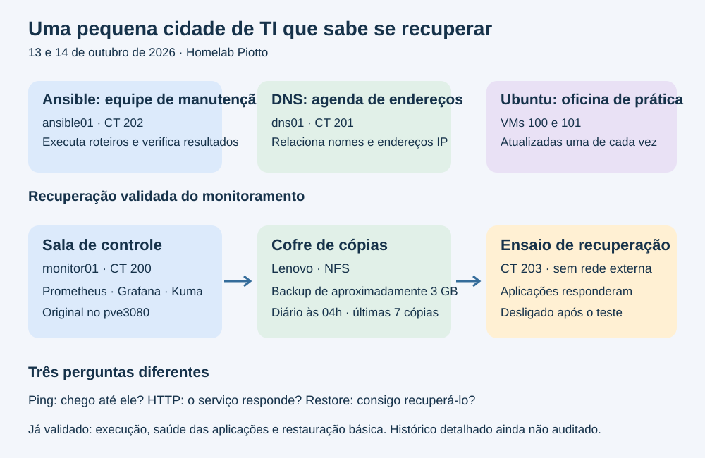
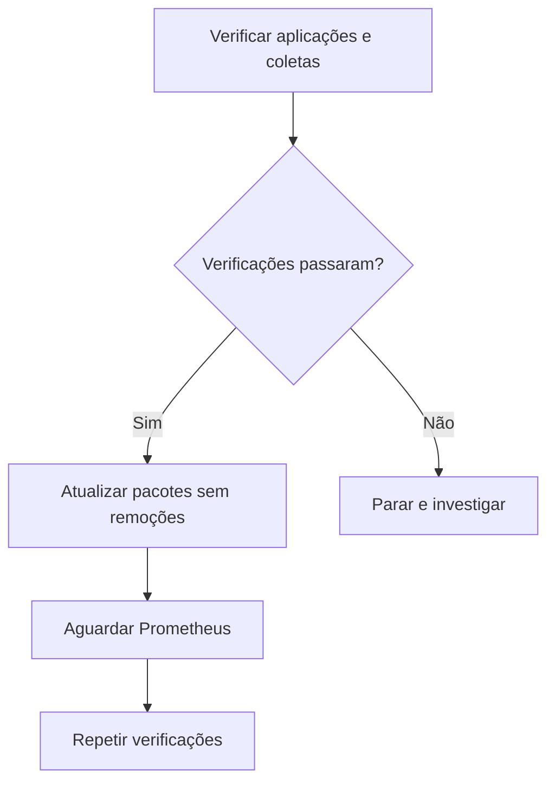
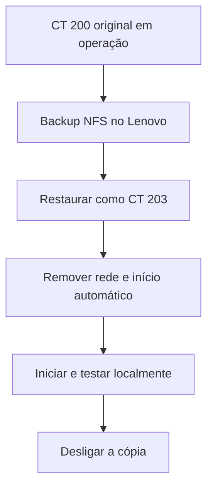

# Dois dias aprendendo a cuidar de uma pequena infraestrutura
## Homelab Piotto — 13 e 14 de outubro de 2026

O objetivo deste projeto é aprender infraestrutura na prática e construir evidências para oportunidades em suporte de TI, Linux, redes e operações. Nestes dois dias, o laboratório avançou de “tenho serviços funcionando” para “consigo manter, verificar e recuperar serviços”.



## 1. Imagine o homelab como uma pequena cidade

| Elemento | Analogia | Função real |
| --- | --- | --- |
| Proxmox | Prédios que abrigam os serviços | Executa VMs e containers LXC |
| DNS/BIND | Agenda de endereços | Traduz nomes em IPs e IPs em nomes |
| Ansible | Equipe de manutenção com roteiro | Executa tarefas repetíveis por SSH |
| Prometheus | Equipe que anota medições | Coleta e armazena métricas |
| Grafana | Painel da sala de controle | Apresenta as métricas em dashboards |
| Uptime Kuma | Vigia que faz rondas | Testa disponibilidade dos serviços |
| NFS no Lenovo | Depósito de cópias em outro prédio | Armazena backups fora do host de origem |
| Restauração isolada | Ensaio de emergência | Verifica se uma cópia consegue iniciar os serviços |

As analogias ajudam a entender os papéis; não significam que exista alta disponibilidade automática ou proteção completa contra todos os tipos de falha.

## 2. Ontem, 13/10: manutenção organizada das VMs Ubuntu

Criamos e validamos o playbook `maintenance.yml` para as duas VMs Ubuntu. Ele consulta o kernel, atualiza a lista APT, instala atualizações, verifica a indicação de reboot, reinicia quando necessário e consulta o kernel novamente.

O ponto principal foi `serial: 1`: terminar o trabalho em uma VM antes de passar à próxima. É como reformar uma sala por vez, conferindo o resultado antes de continuar. Isso limita o alcance de uma mudança, embora não crie redundância entre serviços diferentes.

Resultado registrado nas duas VMs: kernel `6.8.0-146-generic` → `6.8.0-147-generic`, reinícios concluídos e nenhuma atualização pendente na verificação final.

O teste com `--check` também ensinou uma limitação: alguns módulos não executam consultas nesse modo. Aplicamos `check_mode: false` a comandos de leitura verificados, para coletar informações reais enquanto a atualização continuava simulada.

**Aplicação profissional:** executar uma mudança com escopo definido, testar antes, reduzir impacto e registrar evidências após a execução.

Referência: [sessão detalhada de manutenção Ubuntu](ansible-maintenance-2026-10-13.md).

## 3. Ontem, 13/10: o DNS entrou na administração pelo Ansible

O `dns01` foi organizado no grupo `[dns]`, com parâmetros em `group_vars/dns.yml`: usuário `ansible` e Python `/usr/bin/python3`.

Verificamos o BIND e as zonas `home.arpa` e reversa. A consulta de `pve.home.arpa` retornou `192.168.1.164`, e a resolução reversa também foi validada. Atualizamos `liblzma5` e `xz-utils`.

O arquivo `/var/run/reboot-required` não existia ao final. Isso significa ausência desse indicador; em Debian, sua ausência isolada não prova que nenhum serviço ou host precise reiniciar. Um LXC compartilha o kernel do host Proxmox.

**Por que fizemos isso?** Um DNS pode responder ao ping e ainda resolver nomes incorretamente. Testar o serviço e os registros confirma a função que realmente interessa aos usuários.

Também foi resolvido um problema físico do Lenovo: a substituição da fonte eliminou o zumbido elétrico, conforme observado após a instalação. Isso ajudou a manter utilizável o equipamento destinado ao armazenamento.

## 4. Hoje, 14/10: encontramos o lugar certo de administrar

Identificamos o `monitor01` como CT 200 no `pve3080`. O controlador Ansible é outro container: CT 202 `ansible01`, hospedado no `pve3080b`.

Durante a sessão, houve uma confusão entre o shell do host e o shell do container. A identificação com `whoami`, `hostname`, `pct list` e `command -v ansible` permitiu corrigir o ponto de execução.

**Lição:** o prompt funciona como uma placa na porta. Antes de executar uma tarefa administrativa, confirmar “quem sou?” e “em qual máquina estou?” evita aplicar uma ação no lugar errado.

Uma chave pública do host `pve3080b` foi autorizada inicialmente; depois autorizamos e testamos a chave Ed25519 correta do `ansible01`. A autorização adicional do host não foi removida nesta sessão e fica como item para revisão de acessos.

## 5. Hoje: acesso remoto com identidade e permissões

Comparamos a impressão digital SSH apresentada na conexão com a chave pública obtida pelo console do próprio `monitor01`. Isso confirmou a identidade do servidor antes de aceitá-lo.

Criamos o usuário `ansible`, instalamos `sudo`, adicionamos a conta ao grupo `sudo` e verificamos `sudo whoami` → `root`.

Copiamos apenas a chave pública do controlador. A chave privada permaneceu nele. O teste SSH com `BatchMode=yes` retornou `ansible` e `monitor01` sem pedir senha. As tarefas privilegiadas continuam pedindo a senha de sudo com `-K`; não configuramos sudo sem senha.

Adicionamos o grupo `[monitoring]` ao inventário e criamos `group_vars/monitoring.yml`. O módulo Ansible `ping` respondeu `pong`.

**Atenção à diferença:** ping de rede testa resposta ICMP. O ping do Ansible testa conexão e execução do Python remoto.

## 6. Hoje: atualizamos sem perder a capacidade de observar

Antes da mudança, os três containers Docker estavam em execução. Conferimos também a política `unless-stopped`, que permite retorno automático após reinício do Docker quando o container não foi parado manualmente.

A simulação APT mostrou **10 atualizações, nenhuma instalação nova e nenhuma remoção**. Aplicamos as atualizações com o módulo APT do Ansible, incluindo Docker, containerd, curl e bibliotecas.

Isso atualizou os pacotes do sistema e do mecanismo Docker. **Não executamos pull nem recriamos as imagens das aplicações**; Grafana, Prometheus e Kuma continuaram com as imagens já existentes.

Os containers reiniciaram e voltaram. Depois validamos por camadas:

| Camada | Evidência obtida | O que demonstra |
| --- | --- | --- |
| Processo | Os três containers em execução | Os processos iniciaram |
| Prometheus | HTTP 200 em `/-/ready` | Aplicação pronta para requisições |
| Grafana | HTTP 200 e `database: ok` | Aplicação responde e acessa seu banco |
| Kuma | Container healthy e HTTP 200 | Verificação interna e interface respondem |
| Coleta | Seis séries `up = 1` | A última coleta funcionou para todos os alvos retornados |
| Painel | Usuário confirmou todos verdes no Kuma | Os monitores mostravam disponibilidade |

Os seis alvos retornados foram Prometheus, pve3080, pve, pve3090, pve3080b e dns01. `up = 1` não comprova que todo serviço do host está perfeito: indica sucesso da coleta daquele alvo.

## 7. Hoje: transformamos os testes em roteiros reutilizáveis

Criamos:

- `monitoring-check.yml`: quatro consultas HTTP e uma asserção para verificar os alvos retornados pelo Prometheus.
- `monitoring-maintenance.yml`: importa as verificações, atualiza pacotes, espera o Prometheus e repete as verificações.

Fluxo lógico:



O teste detecta resultado vazio ou alguma série com valor diferente de 1. Ele não mantém uma lista obrigatória de alvos; portanto, não detecta sozinho um alvo removido da configuração.

O primeiro dry run falhou porque as consultas HTTP foram puladas e a asserção tentou acessar um JSON inexistente. Corrigimos as quatro consultas de leitura com `check_mode: false`.

Resultados finais:

- Verificação: `ok=5 changed=0 unreachable=0 failed=0`.
- Simulação de manutenção: `ok=12 changed=0 failed=0 skipped=1`; a espera HTTP foi pulada.
- Manutenção normal: `ok=13 changed=0 unreachable=0 failed=0`.

O último resultado demonstra idempotência no estado observado: executar novamente não criou alterações desnecessárias. A espera explícita cobre apenas o Prometheus; Grafana e Kuma têm testes finais sem repetição automática, uma melhoria futura caso iniciem mais lentamente.

Comandos reutilizáveis, dentro de `/root/ansible-lab` no `ansible01`:

```bash
ansible-playbook -i inventory.ini monitoring-check.yml
ansible-playbook -i inventory.ini monitoring-maintenance.yml -K --check
ansible-playbook -i inventory.ini monitoring-maintenance.yml -K
```

## 8. Hoje: levamos a cópia de segurança para outro equipamento

O `pve3080` não tinha o destino Lenovo cadastrado. O NFS existente aceitava apenas o `pve3090`. Preservamos essa autorização e acrescentamos o `pve3080`, sem liberar toda a rede.

Destino: `192.168.1.164:/mnt/pve-backup`, cadastrado como `lenovo-backup`. O compartilhamento manteve `no_root_squash`: os roots dos clientes autorizados têm acesso privilegiado ao export. Isso merece revisão conforme o laboratório evolui.

A configuração do CT 200 tinha apenas o rootfs de 32 GB, sem mounts externos listados. Fizemos o backup em modo `stop`, para copiar o filesystem com o container parado. Houve indisponibilidade planejada do monitoramento.

Resultado registrado:

- Backup: `vzdump-lxc-200-2026_10_14-10_47_09.tar.zst`.
- Tamanho: 3.219.968.580 bytes, aproximadamente 3 GB.
- Duração: 1 minuto e 2 segundos.
- Término no log: 14/10/2026 às 10:48:11.
- Container online novamente e cinco testes posteriores aprovados.

Configuramos um job diário às **04:00**, horário do host, em modo stop, ZSTD e retenção `keep-last=7`. O agendamento foi conferido; a execução automática futura ainda não foi observada. As VMs Ubuntu já tinham job separado às 03:00 no pve3090.

**Por que outro equipamento?** Se o disco do host original falhar, a cópia pode continuar no Lenovo. Isso ainda não é cópia externa ao local nem protege contra toda falha compartilhada, exclusão ou comprometimento. O SSD de backup já tem uso elevado documentado no projeto.

## 9. Hoje: abrimos o “paraquedas” em um ensaio seguro

Backup concluído não basta para afirmar que conseguimos recuperar o serviço. Restauramos o arquivo como CT **203**, preservando o original CT 200.

Antes de iniciar a cópia, removemos `net0`, desativamos `onboot` e mudamos o hostname para `monitor01-restore-test`. Assim, a cópia não entrou na rede doméstica com a identidade do original.



Dentro do CT 203, os três containers Docker iniciaram. Os testes locais confirmaram Prometheus pronto, Grafana com banco ok e Kuma HTTP 200. Depois desligamos a cópia.

**Limite do teste:** validamos restauração, inicialização e saúde básica das aplicações. Não auditamos individualmente dashboards, monitores configurados, usuários e integridade do histórico. Os alvos externos ficam inacessíveis na cópia sem rede, como esperado.

## 10. Como isso ajuda no objetivo profissional?

| Atividade prática | Habilidade demonstrada | Exemplo de situação no trabalho |
| --- | --- | --- |
| Identificar host e container | Diagnóstico por camadas | Evitar alteração no servidor errado |
| Conferir fingerprint e usar chaves | Administração remota | Validar identidade e autenticação |
| Ansible, grupos e variáveis | Automação | Repetir procedimentos com consistência |
| Simular e atualizar sequencialmente | Gestão de mudanças | Reduzir impacto de manutenção |
| HTTP, banco e métricas | Validação de serviço | Diferenciar processo ativo de função saudável |
| Corrigir erro de check mode | Troubleshooting | Interpretar falhas e testar a correção |
| NFS, retenção e agendamento | Operação de backups | Manter cópias com espaço controlado |
| Restaurar sem rede | Recuperação de serviço | Ensaiar um incidente sem afetar produção |
| Registrar resultados e limites | Documentação | Permitir que outra pessoa entenda e repita o trabalho |

São evidências práticas de aprendizado, não uma certificação ou garantia de domínio completo. O valor do portfólio aumenta quando consigo explicar a decisão, mostrar a saída e reconhecer o que o teste ainda não provou.

## 11. O que ficou para depois

- Conferir a primeira execução automática do backup às 04:00.
- Revisar a chave adicional autorizada a partir do host pve3080b.
- Guardar os playbooks sob controle de versão após comparar o conteúdo dos arquivos reais.
- Estender cobertura de backups ao dns01 e ao ansible01, se ainda não houver proteção confirmada.
- Auditar conteúdo e histórico em um próximo teste de restauração.
- Definir cópia fora do ambiente e revisar retenção/capacidade.
- Prosseguir com NAS de arquivos, VPN e revisão de segurança.
- Se escolher segmentação por VLAN, considerar que o switch atual é não gerenciável.

A estimativa visual anterior de 63% foi uma organização orientativa de 32 marcos com pesos iguais, não uma medição de esforço restante nem uma métrica oficial do repositório.

**A principal conquista dos dois dias:** começamos a cuidar do ciclo de vida do serviço — preparar, mudar, conferir, copiar e recuperar — em vez de apenas instalá-lo.
